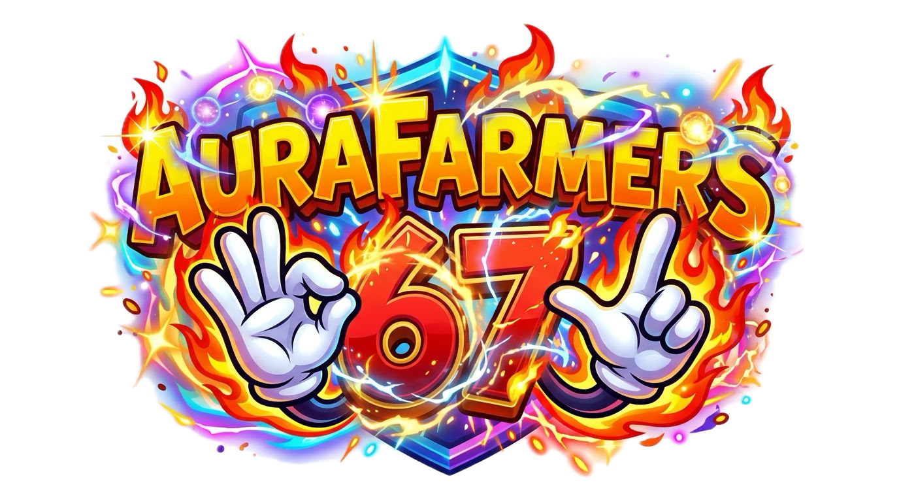

<p align="center">
  
</p>

<h1 align="center">⚡ Aura Farmers 67 ⚡</h1>

<p align="center">
  <b>Arcade en tiempo real impulsado por Visión por Computadora con MediaPipe, Next.js y WebGL</b>
</p>

<p align="center">
  
  
  
  
  
  
</p>

---

## 📖 Acerca del Juego

**Aura Farmers 67** es un videojuego interactivo de arcade que utiliza tu cámara web y modelos de visión por computadora de última generación para rastrear tus manos y cuerpo en tiempo real.

El objetivo del juego es **cosechar la mayor cantidad de Aura en el mundo**: realiza el emblemático gesto de la **Balanza 6 7** frente a tu cámara, encadena combos masivos, carga la barra de energía y activa el **Sobredisparo 5X** para liderar la clasificación semanal mundial.

> 🔒 **100% Privado y Seguro:** Todo el procesamiento de video e inteligencia artificial se ejecuta localmente en tu navegador. Tus imágenes nunca salen de tu dispositivo.

---

## ✨ Características Principales

### 👐 1. Detección de Gestos en Tiempo Real (MediaPipe)
- Detección esqueletal de 21 puntos clave por mano a 60 FPS.
- Cálculo de la **Balanza 6 7**: mide el diferencial de altura entre ambas manos de forma alterna y rítmica.
- Multiplicadores de combo dinámicos con retroalimentación visual, partículas y efectos de sonido.

### 👊 2. Sobredisparo 5X (Overdrive)
- **Barra de Energía de 10,000 Puntos:** Ubicada de forma sutil en la parte superior con llenado y vaciado líquido fluido.
- **Activación por Gesto Físico:** Al llenarse la barra, **cierra ambos puños y empuja hacia la pantalla** para desatar el multiplicador **5X Overdrive**.
- Filtro cinemático de ondas en los bordes de la cámara durante 7.5 segundos y tiempo de recarga (cooldown) de 20 segundos.

### 🛍️ 3. Tienda de Cosméticos 3D en Vivo
- **Guanteletes 3D:** Guantes Cibernéticos, Fénix de Fuego, Dragón Oscuro, Neón y Mágicos renderizados directamente sobre el esqueleto de tus manos.
- **Accesorios de Cabeza:** Auriculares Cyberpunk, Coronas de Campeón, Halos Neón y Cuernos Místicos rastreados en tu cabeza.
- **Estelas de Aura:** Ondas de energía que emanan de tus movimientos.

### 🟡 4. Economía de Aura y Monedas
- Conversión justa de **10:1**: cada 10 puntos de Aura cosechados en rondas se convierten en 1 Moneda de Aura.
- Desbloquea objetos exclusivos en la tienda que persisten en tu cuenta.

### 🏆 5. Clasificación Semanal y Llave Secreta
- Tabla de clasificación global que se reinicia semanalmente (lunes a las 00:00 UTC).
- **Llave Secreta de Perfil (`AURA-XXXX`):** Respalda y restaura tus puntos, estadísticas y cosméticos en cualquier computadora o navegador.

### 🔄 6. Función de Renacer (Rebirth)
- Disponible en el panel de Ajustes para jugadores veteranos que buscan reiniciar sus puntos de Aura a 0 y emprender un nuevo reto.
- Modal de seguridad que exige escribir tu nombre de usuario exacto para confirmar la acción.

### 🎙️ 7. Guía Interactiva con Voz
- Botón **`?`** en el menú principal para iniciar un tour interactivo paso a paso impulsado por **Driver.js**.
- Locución estilo intercomunicador arcade sincronizada que explica cómo jugar y cómo usar cada botón.
- *Audio ducking* inteligente: atenúa la música de fondo automáticamente mientras la guía está activa.

### 🎵 8. Banda Sonora Arcade Phonk
- Reproductor de música integrado con canciones phonk enérgicas, control de volumen fino, saltar canciones y modo silencioso.

---

## 🚀 Instalación y Puesta en Marcha

### Prerrequisitos
- [Node.js](https://nodejs.org/) (versión 18 o superior recomendada)
- [pnpm](https://pnpm.io/) (o npm / yarn / bun)
- Una cámara web o cámara integrada conectada

### Pasos de instalación

1. **Clonar el repositorio:**
   ```bash
   git clone git@github.com:EduardoToledo-WebDev/aurafarmers.git
   cd aurafarmers
   ```

2. **Instalar dependencias:**
   ```bash
   pnpm install
   ```

3. **Ejecutar el servidor de desarrollo:**
   ```bash
   pnpm dev
   ```

4. **Abrir en tu navegador:**
   Visita [http://localhost:3000](http://localhost:3000) y haz clic en **"PERMITIR Y COMENZAR"** para habilitar la cámara.

---

## 🎮 Controles y Cómo Jugar

| Acción | Gesto o Botón |
|---|---|
| **Farmear Aura** | Sube y baja las manos alternadamente frente a la cámara (Balanza 6 7) |
| **Activar Sobredisparo 5X** | Llena la barra de 10,000 pts, cierra los puños y empuja hacia la cámara |
| **Abrir Tienda** | Botón verde **TIENDA** en el menú o barra superior |
| **Ver Tabla Mundial** | Botón morado **TOP SEMANAL** |
| **Ajustes y Renacer** | Botón azul **AJUSTES** |
| **Guía Interactiva** | Botón **`?`** en la esquina superior derecha del menú principal |

---

## 🛠️ Tecnologías Utilizadas

- **Framework:** [Next.js 16](https://nextjs.org/) (App Router + Turbopack)
- **Biblioteca UI:** [React 19](https://react.dev/)
- **Visión por Computadora:** [@mediapipe/tasks-vision](https://developers.google.com/mediapipe)
- **Estilos:** [Tailwind CSS v4](https://tailwindcss.com/)
- **Guía Interactiva:** [Driver.js](https://driverjs.com/)
- **Iconografía:** [Lucide React](https://lucide.dev/)
- **Efectos:** Canvas Confetti

---

## 📄 Licencia

Este proyecto fue desarrollado con fines educativos y de entretenimiento. Todos los derechos reservados.
